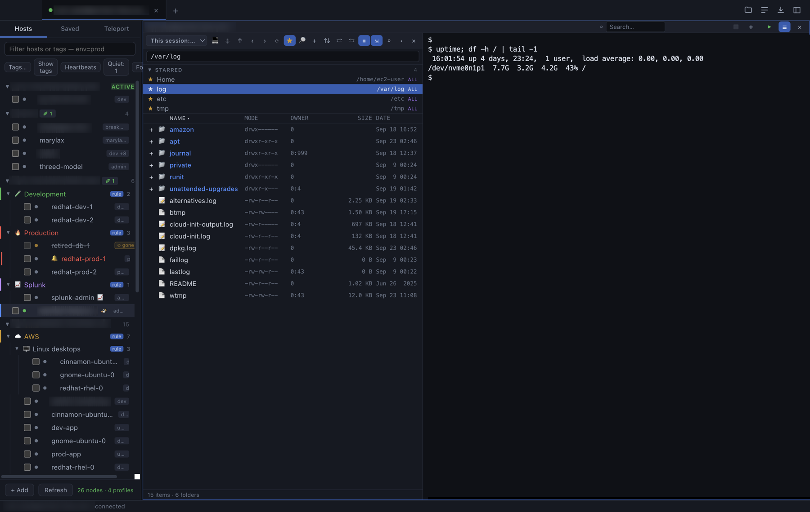
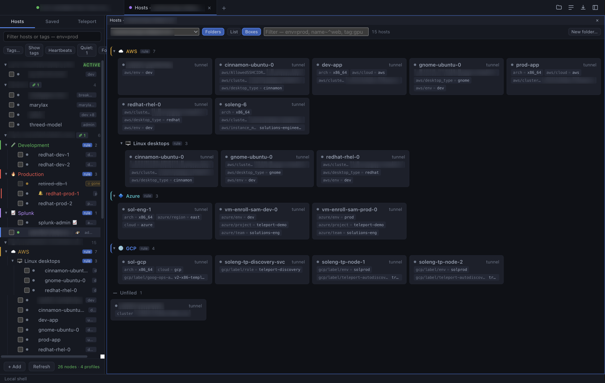
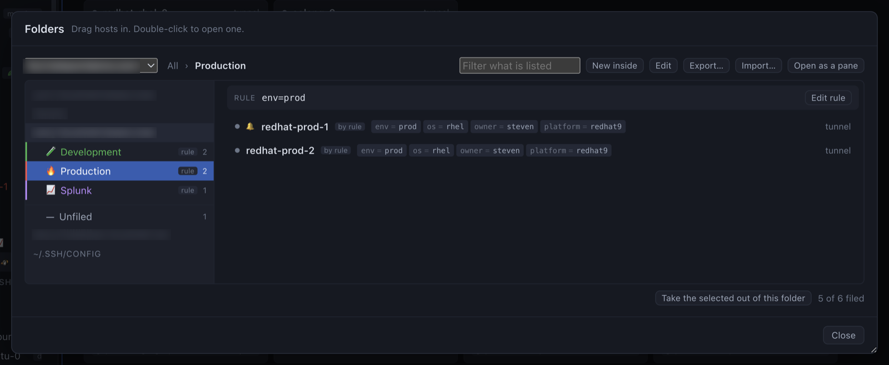
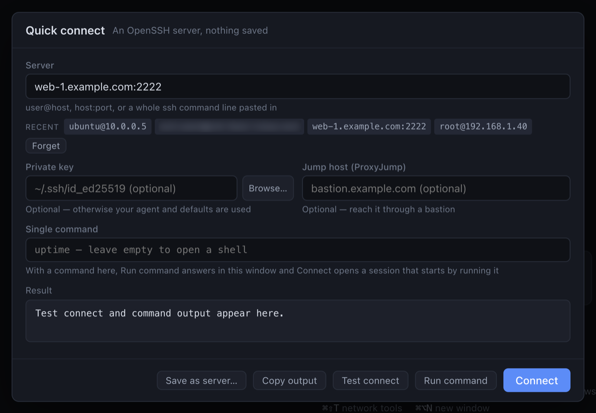

<div align="center">

# ServerLife

**A maximum SSH-style desktop interface for Teleport, SSH and Kubernetes.**

Tabbed terminals, a real SFTP file browser, fleet-wide command execution,
port forwarding and session replay — with Teleport nodes, beams, plain SSH
hosts and Kubernetes clusters treated as the same thing.

macOS · Linux · Windows

**[Quickstart →](QUICKSTART.md)**

</div>

---



<sub>Folders down the side — filled by hand or by a tag rule — a session, and
the file browser riding the same connection. `retired-db-1` is struck through
because it was being watched and has left the inventory.</sub>

### A look at the rest

| | |
|---|---|
|  | **A whole cluster in a pane.** Folders on or off, rows or tiles, the same filter language, and drag onto a folder heading to file something. The sidebar stops at twenty hosts per group and offers this for the rest. |
|  | ** Full Kubernetes browsing ** on existing k8s clusters, Teleport protected ones and easily add Teleport integration. Wizards to help add mapping from clusterroles, roles into Teleport roles. |

|  | **Folders, with room to arrange them.** A tree, what is in the selected folder, and the rule that fills it — `env=prod` here — above the hosts it currently claims. |
|  | **Quick connect**, for a server that is in no list yet: `user@host`, a pasted ssh command line, or one of the recent ones underneath. It can test the connection or run a single command without opening a terminal. |


## Why it exists

Working across a fleet usually means a terminal in one window, a file transfer
tool in another, a pile of `ssh -L` commands in a third, and no connection
between any of them. ServerLife puts the whole workflow in one desktop
interface: a host list down the side, terminals in tabs, and a file browser
attached to the session you are already in.

It is built around `tsh` and OpenSSH. The important design decision is
underneath: **every connection opens exactly one SSH ControlMaster**, and
terminals, the file browser, transfers, port forwards and multi-exec all ride
that single authenticated connection.

That is why the file browser appears instantly when a session connects, why you
tap your MFA key once instead of once per panel, and why opening ten terminals
to one host creates one Teleport session, not ten.

---

## Contents

- [Install](#install)
  - [macOS: "Apple could not verify…"](#macos)
  - [Windows: SmartScreen](#windows)
  - [Linux](#linux)
  - [Requirements](#requirements)
- [Quick start](#quick-start)
- [What it does](#what-it-does) — the summary; **[GUIDE.md](GUIDE.md)** has all of it
- [Automation and MCP](#automation-and-mcp) — and [MCP.md](MCP.md) in full
- [Keyboard shortcuts](#keyboard-shortcuts)
- [Building from source](#building-from-source)
- [How it works](#how-it-works)
- [Warnings and limitations](#warnings-and-limitations)
- [Troubleshooting](#troubleshooting)
- [Version history](#version-history)
- [Uninstalling](UNINSTALL.md)

### The other documents

| | |
|---|---|
| **[GUIDE.md](GUIDE.md)** | What everything does, in detail. Also in the app: **Help → Guide** (`⌘/`) |
| [QUICKSTART.md](QUICKSTART.md) | Install and first run, condensed to one page |
| [MCP.md](MCP.md) | Driving the app from an agent: the control socket, the MCP server, every verb |
| [TESTING.md](TESTING.md) | Manual acceptance tests — what to click and what should happen |
| [UNINSTALL.md](UNINSTALL.md) | Everything the app writes, and how to remove it |

---

## Install

Download the build for your platform from the
[releases page](https://github.com/stevenGravy/serverlife/releases).

| Platform | File |
|---|---|
| macOS (Apple Silicon) | `ServerLife-<version>-macOS-arm64.dmg` |
| Linux x64 | `ServerLife-<version>-linux-x64.AppImage` or `.deb` |
| Linux arm64 | `ServerLife-<version>-linux-arm64.AppImage` or `.deb` |
| Windows x64 | `ServerLife-<version>-windows-x64.exe` |

> [!IMPORTANT]
> **The builds are not signed with a paid developer certificate, so every
> operating system warns about them on first run — macOS offers to move the app
> straight to the Trash.** This is expected, and the warning is about the
> missing signature rather than anything found in the app. Each platform's way
> through it is below. If you would rather not work around it, build from
> source instead: [Building from source](#building-from-source).

### Check what you downloaded first

Every release has a `SHA256SUMS.txt`. Since you are about to tell your OS to
trust an unsigned binary, it is worth confirming you have the file the build
produced:

```sh
shasum -a 256 ~/Downloads/ServerLife-*                  # macOS
sha256sum ~/Downloads/ServerLife-*                      # Linux
```

```powershell
Get-FileHash .\ServerLife-<version>-windows-x64.exe    # Windows
```

Compare with the matching line in `SHA256SUMS.txt` on the release page.

### macOS

The app is **ad-hoc signed and not notarised** — notarising requires a paid
Apple Developer account — and your browser flags anything it downloads. On
macOS 15 and later that combination produces:

> "Apple could not verify 'ServerLife' is free of malware that may harm your
> Mac or compromise your privacy."

with **Move to Trash** as the default button. Control-click → *Open*, which
used to be the way round this, **no longer works for unnotarised apps.** Two
things do.

**Option 1 — install from the command line** (clears the flag before the first
launch, so no warning ever appears):

```sh
V=0.1.14   # the version you downloaded
hdiutil attach ~/Downloads/ServerLife-$V-macOS-arm64.dmg
ditto "/Volumes/ServerLife $V-arm64/ServerLife.app" /Applications/ServerLife.app
hdiutil detach "/Volumes/ServerLife $V-arm64"
xattr -dr com.apple.quarantine /Applications/ServerLife.app
open -a ServerLife
```

`ditto` rather than `cp`: it keeps the bundle's symlinks and permissions, and a
mangled bundle fails to launch for reasons that look nothing like the cause.

Those four lines are the whole of it — **no script to download.** If you would
rather run one command that also checks the result, `install-mac.sh` is attached
to every release:

```sh
gh release download --repo stevenGravy/serverlife serverlife-v<version> -p install-mac.sh
chmod +x install-mac.sh
./install-mac.sh ~/Downloads/ServerLife-<version>-macOS-arm64.dmg
```

`gh` handles the authentication a private repository needs. Without `gh`,
download `install-mac.sh` from the release page in your browser alongside the
DMG, then `chmod +x install-mac.sh` and run it the same way. (A repository
clone has it at `tools/install-mac.sh`.)

**Option 2 — let macOS block it once, then allow it**:

1. Open the DMG and drag ServerLife to Applications.
2. Open it. At the warning, press **Done** — *not* Move to Trash.
3. **System Settings → Privacy & Security**, scroll down to the line about
   ServerLife, press **Open Anyway**, and confirm.

Either way you are choosing to run a binary macOS could not verify, which is
why the checksum above is worth a moment.

To remove the warning properly you need an Apple Developer ID: the release
workflow signs and notarises when `MAC_CERT_P12`, `MAC_CERT_PASSWORD`,
`APPLE_ID`, `APPLE_APP_PASSWORD` and `APPLE_TEAM_ID` are set as repository
secrets, and falls back to ad-hoc signing when they are absent.

### Windows

The installer is unsigned, so SmartScreen shows:

> "Windows protected your PC" / "Microsoft Defender SmartScreen prevented an
> unrecognised app from starting."

Press **More info**, then **Run anyway**. Nothing else is needed — Windows does
not delete the file, and the choice is remembered for that copy.

The `.exe` is a per-user installer and needs no administrator rights. The
`.zip` is the same app unpacked, for running without installing.

### Linux

```sh
sudo apt install ./ServerLife-<version>-linux-amd64.deb   # Debian, Ubuntu
```

Or the AppImage, which needs the execute bit and nothing else:

```sh
chmod +x ServerLife-<version>-linux-x86_64.AppImage
./ServerLife-<version>-linux-x86_64.AppImage
```

On a minimal system an AppImage may need FUSE (`sudo apt install libfuse2`), or
run it with `--appimage-extract-and-run`.

### Requirements

- **OpenSSH client** (`ssh`, `ssh-keygen`) — present by default on macOS and
  Linux; on Windows it is an optional feature (Settings → Apps → Optional
  features → OpenSSH Client). Needed for plain SSH hosts; **Teleport nodes work
  without it**, over `tsh ssh`.
- **`tsh`** — only if you use Teleport. ServerLife looks in the usual places:
  `/usr/local/bin`, Homebrew and Teleport Connect on macOS; on Windows,
  Teleport Connect's own directory, `C:\Program Files\Teleport`, chocolatey and
  scoop. Anywhere else, point at it with Settings → *Locate tsh / ssh…*.
- **`kubectl`** — only for Kubernetes. Without one, Teleport-reached clusters
  go through the `kubectl` built into `tsh` (`tsh kubectl`) instead.
- **`helm`** — only for the Helm view and the Teleport agent installer. Found
  beside `kubectl`, in Homebrew and the other usual places, then on `PATH`;
  `k9s`, `stern`, `kubectx` and friends are picked up the same way.
- **XQuartz** (macOS) or an X server — only if you want X11 forwarding.

Removing it again: [UNINSTALL.md](UNINSTALL.md).

---

## Quick start

0. **First run offers a guided tour** — sixteen steps that point at each part of
   the window and say what it is for. It is in **Help → Take the Tour…**
   afterwards, and you can leave it at any point.
1. Log in to Teleport if you use it: `tsh login --proxy=your.proxy.com`
2. Launch ServerLife. The sidebar fills with your Teleport nodes, every
   `Host` in `~/.ssh/config`, and your Kubernetes clusters — those Teleport
   offers (`tsh kube ls`) inside their cluster, the rest of your kubeconfig
   under *Local kubeconfigs*. *All · SSH · K8s* above the list picks which.
3. Double-click a host. A terminal opens and the file browser attaches to the
   same connection.
4. Drag a file from Finder onto the file browser to upload it.
5. For a server that is in neither list, `⌘⌥C` and type `user@host` —
   see [Quick connect](#connections).

---

## What it does

The detail is in **[GUIDE.md](GUIDE.md)** — every panel and every menu, and the
reasoning where it matters. It is also *in the app*: **Help → Guide** (`⌘/`)
opens the same text with a section list and a search box.

The short version:

- **Every host in one list.** Teleport nodes from every logged-in profile with
  their labels, `ssh_config` hosts from one or several config files, leaf
  clusters shown and switchable, and beams listed under the cluster they run
  on. Star the ones you use, drag them into the order you want, give one a
  colour so you know production when you see it, and pin the account each
  connects as.
- **One authentication per host.** A session opens exactly one SSH
  ControlMaster; terminals, the file browser, transfers, tunnels and remote
  commands all ride it. One MFA tap, not one per panel.
- **Tabs, splits and broadcast typing**, plus local shells — including any
  shell on the machine, with or without its startup files.
- **A real SFTP browser**, not a wrapper around the `sftp` command: two panes,
  drag between two servers, sortable column headings, permissions and owner
  columns with a plain-English reading of any mode, recursive
  `chmod`/`chown`/`chgrp`, compare two folders, synchronise them with every
  action shown and tickable first, keep a local folder uploading as you save,
  edit a remote file in your own editor, starred folders and files, a
  recursive search by name or contents, and a history of what you have
  downloaded.
- **A transfer queue you can steer** — pause and resume, retry a dropped
  transfer from where it stopped, reorder what is waiting, and cap the speed.
- **Fleet operations** — multi-exec across ticked hosts *or* everything matching
  a tag, resolved when it runs, with recent runs kept so the same question can
  be asked again, and YAML and Ansible export. Under *Advanced*: a staged
  rollout, and retries — a host that fails is tried again so many times, so
  many seconds apart. *Schedule…* runs it at a date and time, once or every so
  many minutes, hours, days or weeks, ending never, after a number of runs or
  on a date; the *Scheduled* tab lists, pauses, edits and runs them now.
  Schedules run while ServerLife is open, and one due while it was closed is
  counted as missed rather than run late.
- **Port forwarding** with favourites that reopen a tunnel on the right host.
- **Macros** with variables, defaults and value lists, each saying whether it
  belongs on hosts, in the local shell or both, and pinned to a session's
  header as buttons if you want them there. Or record one: *Record a macro* on
  a pane's menu, run the commands as usual, stop, and review the steps — what
  ran, with Tab completion and history as they came out, and no passwords.
  Forty-eight built in, including Teleport agent health, proxy reachability,
  clock sync, `teleport status` for the SSH session you are in, and `beamctl`
  and Phase-build commands inside a beam.
- **Keyword highlighting** in the terminal: errors, warnings and good news
  coloured as the output arrives, configurable globally or per host.
- **Teleport** — several profiles at once, access requests with an indicator
  when any are outstanding, `tsh status` on any cluster, session recordings with
  playback and transcript search, tag search over labels, `tsh config` written
  into `~/.ssh/config` for the tools that only speak ssh, and latency measured
  to a node. A saved cluster can be pinned to the Hosts tab, so logging out
  does not take its group and its watched hosts with it.
- **Beams and Phases** — beams listed inside their cluster (beams.sh and
  beams.run clusters by default), started from a saved Phase with chosen roles
  delegated, and Phases built, forked, edited and deleted from a tab beside
  them, each with its history and the beams running it.
- **KubeLife — Kubernetes beside your servers.** Clusters from the kubeconfig
  and from Teleport sit in the same tree, folders and filter as SSH hosts; one
  setting turns it all off and leaves no trace. See
  [GUIDE.md](GUIDE.md#kubelife).
  - **Namespaces and pods in the tree**; exec into a container (split or a tab
    of its own) with the same file browser a server session gets; logs,
    including the previous container's after a crash.
  - **A full cluster browser**: every resource kind, custom ones too, with
    search, sort and columns sized to their content; YAML edit with a diff
    shown before it applies, describe, delete, cordon and drain, a live events
    feed, `kubectl top`, and an overview whose counts open the pods behind them.
  - **My access** — who the cluster sees you as, your groups, a grid of what
    you can do, and a *Can I…?* box (`kubectl auth can-i`).
  - **Helm** — releases, values, history and rollback; install and upgrade
    with a dry-run default, values passed as YAML, and the exact command shown
    live so it can be copied and run by hand.
  - **Put a cluster behind Teleport** — `teleport-kube-agent` with kube, app
    and discovery roles, labels and automatic updates; the join token is made
    on, and checked against, the cluster you pick. Exports a `values.yaml`.
  - **Diagrams** — what a Helm release installs and how it connects, and a 3D
    view of the cluster with Service → Deployment → Pod arrows; both export as
    Mermaid.
  - **Kubernetes profiles** (a context, a namespace, a view to open on) and a
    **Map a Teleport group to a ClusterRole** wizard: the binding in the
    cluster, and the Teleport role (`kubernetes_groups`) to go with it.
  - **Stars**, port-forwards and `tsh proxy kube`, k9s and a ready shell,
    access requests and MFA marking for kube clusters, and an offer to
    reconnect your clusters after logging in again.
- **Put an SSH host behind Teleport** — a connected host with no Teleport agent
  gets ⚡ *Add to Teleport*: the chosen cluster's own `install.sh` (its exact
  version, with managed updates), then `teleport node configure` with a node
  name and labels, typed into the session so sudo can ask for its password.
- **Edit ssh configs and kubeconfigs in the app** — colour-coded, with
  suggestions to copy or insert, and checked by `ssh -G` / `kubectl config
  view` before anything is saved; plus a picker of common ssh options (only
  one key file, no keys, no agent…) for hosts and saved profiles.
- **Folders in the host list**, per cluster and per ssh_config: drag a node in,
  or give the folder a tag rule — `env=prod and (role:web or role:api) and not
  name=web-canary` — and it fills itself. Nested, with icons and colours, a
  file-manager view for doing the filing, and the whole arrangement exports to
  a file a colleague can import.
- **A hosts pane** — a cluster's inventory given the space a terminal would
  have had, with folders on or off, rows or tiles, and the same filter
  language. The sidebar stops at twenty hosts per group and offers the pane
  for the rest, so one large cluster cannot push every other group off the
  bottom.
- **Nodes that have gone quiet**, marked while they are still in the inventory
  — an agent stops heartbeating and the node looks healthy for another ten or
  fifteen minutes, offering a session that will hang. Show the last heartbeat
  on every row, or filter the list down to the ones that have stopped.
- **Hosts that disappear**, if you ask to be told: mark one and its node id
  and last known details are kept, so when it stops being listed the row
  stays — struck through, with how long it has been gone — instead of the
  machine quietly ceasing to exist.
- **Network and certificate tools** — ping, traceroute, DNS, port checks, TLS, HTTP, whois,
  a cluster's `/webapi/ping`, and a full **curl** with saved requests and
  recent runs. Every tool has worked examples, and shows the real command it
  would run — platform-aware, with a Copy button — so the same check can be
  run by hand instead. Five of them run **on a chosen
  host** rather than on your laptop, which is usually the question: a port
  check the server itself makes, an HTTP request resolved and sent from there,
  its own addresses and routes, and ping and traceroute with whatever it has
  installed.
- **tmux sessions that outlive the window.** Open a host in tmux and the work
  stops belonging to the connection: close the lid, lose the network, quit the
  app, and what was running is still running — reattach and the panes, the
  splits and the scrollback are where you left them. tmux windows are tabs and
  tmux panes are panes, with the file browser beside them as on any session.
  Only the server needs tmux; nothing is installed here. Off by default, and
  settable per host, per cluster or everywhere.
- **Consoles and screens** — a serial console, a telnet session, a VNC screen
  drawn in the pane, and a Remote Desktop connection opened in this machine's
  own client. Saved beside your SSH hosts, in the same folders: the machines
  that answer only on a console cable or on port 23 are the ones you reach for
  when SSH is what has stopped working. Serial ports present right now are
  openable from the `+` picker without saving anything, at 115200 8N1.
- **Automation** — a local control socket and a bundled MCP server, off until
  you turn it on. See [MCP.md](MCP.md).

---

## Automation and MCP

ServerLife can be driven by another program — most usefully an agent like
Claude Code — for the part of the work that is pure setup: *open these six
servers*, *load the layout I use for an upgrade*, *which clusters am I logged
into*.

It is **off until you turn it on**: Settings → *Local automation (MCP)*. What it
opens is a socket in your own runtime directory, mode `0600` (a named pipe under
your account on Windows), and every connection has to present a token that only
you can read. Each accepted call appears in the status bar as it happens.

### Registering with Claude Code

With the setting on, Settings shows a *Copy `claude mcp add`* button. It gives
you the line to run:

```sh
claude mcp add serverlife -- node "/Applications/ServerLife.app/Contents/Resources/app.asar.unpacked/mcp/serverlife-mcp.mjs"
```

The bridge finds the running app and reads the token itself, so the command
carries no secret. Other MCP clients work the same way — spawn
`mcp/serverlife-mcp.mjs` over stdio.

**[MCP.md](MCP.md)** has the whole of it: per-platform bridge paths, every
tool's arguments, worked examples, the socket protocol for writing your own
client, and troubleshooting.

### What it can do

| Tool | For |
| --- | --- |
| `serverlife_status` | Version, whether `tsh` and `ssh` were found, which clusters are logged in |
| `serverlife_list_hosts` | Teleport nodes with labels, ssh_config aliases, saved profiles, and Kubernetes clusters |
| `serverlife_open_session` | Open one host — by node name, alias, profile name or `local` |
| `serverlife_open_sessions` | Open a **set** at once; one failure does not stop the rest |
| `serverlife_list_sessions` | What is open now, per tab and pane |
| `serverlife_close_session` | Close one tab, or all of them — **asks first if it's still live** |
| `serverlife_get_settings` / `_set_settings` | Read or change app settings — fonts, cursor, confirmations, and the rest |
| `serverlife_list_layouts` / `_load_layout` / `_save_layout` | Named arrangements of tabs and panes |
| `serverlife_list_clusters` | Teleport profiles: user, expiry, tsh home, saved logins |
| `serverlife_login_command` | The `tsh login` line to paste in a terminal (returns it; does not run it) |
| `serverlife_search` | Search everything in ServerLife, as the box at the top of the window does |
| `serverlife_list_macros` / `_run_macro` | The macros you have saved, and running one — optionally waiting for what it printed |
| `serverlife_type_into_session` | Paste text into a session, and press Enter if asked — **only with your approval** (see below) |
| `serverlife_read_output` | The last lines a terminal pane shows |
| `serverlife_list_beams` | Beams per cluster, with region and expiry |
| `serverlife_sync_preview` | What synchronizing a local folder with a host or beam **would** do — every action, nothing run |
| `serverlife_sync_apply` | Carry out a previewed plan, deleting only if asked |
| `serverlife_list_kube_resource_types` | Every resource kind a logged-in Kubernetes cluster has, CRDs included |
| `serverlife_list_kube_resources` | Resources of one kind — name, namespace, status, age — by namespace or label selector |
| `serverlife_get_kube_resource` / `_describe_kube_resource` | One resource's YAML, or its `kubectl describe` — **read-only**: no apply, delete, scale or exec |

### What it cannot do

There is no verb that runs a command of the caller's choosing on its own.
`run_macro` runs a macro **you** wrote and can read. `type_into_session` is the
one way an agent can put its own text into a terminal, and by default ServerLife
shows you the text and where it would go, and asks — *Don't allow*, *Paste
only*, or *Paste and run*. Settings → *Assistants typing into sessions* can
make that *Allow without asking* or *Never*. `read_output` returns what a pane
shows, which can be anything the session displayed.

File transfer is the one exception, and it is deliberately shaped: `sync_apply`
moves files, so it **only** carries out actions that `sync_preview` listed, it
deletes nothing unless the call says `delete: true`, and it will not remove a
folder that still has files in it. The preview is the review step — an agent
that wants to delete has to show you the list first.

If you would rather revoke access, turn the setting off, or press *New token* —
anything holding the old one stops working immediately.

### The AI assistant panel

The ✦ button in the toolbar, the *AI assistant* row under Local, and the start
screen open an assistant in a panel on the right that stays put as you change
tabs: Claude Code, Codex, GitHub Copilot CLI, OpenCode, Pi or Gemini CLI, or a
tool of your own. Each is started with ServerLife's MCP server already given to
it, so it can use the tools above without a separate `mcp add`.

Before it opens, a check says what is missing — the tool, a sign-in, automation
being off — with a button to fix each. An assistant can be run directly or
through a launcher, a command you type that it is run through (one that routes
it through a gateway, say); that is set per tool under *How each tool runs*,
with the command that will run shown as you edit, or once for all in Settings →
*AI assistant*, where an assistant to open at startup can be chosen too.

Assistants start in a folder of their own, `~/ServerLife AI` (changeable in
Settings), so a tool that asks whether to trust its folder asks once. Beside
that:

- **Ask the AI about this** — right-click selected output (or a pane with
  nothing selected, for what is on screen), or a host in the list. It is put
  into the assistant's input with where it came from, for you to add the
  question.
- **Prompts** in the panel's header keeps the questions you ask often.
- **Save** keeps an answer: the selection, the screen or the whole
  conversation, named, as Markdown in `~/ServerLife AI/saved`. *Saved
  responses…* reads them back, copies them, or gives one to the assistant again.
- **Pick up a past conversation** carries on the last one, or chooses from the
  tool's own list, where the tool has one.
- **Names** — double-click a tab to rename it; a name given when it opens is
  passed to tools that take one (Claude Code, Copilot, Pi).

### Search everything

The box at the top right of the window (`⌘P`; `Ctrl+Alt+P` on Windows and
Linux) finds anything in ServerLife by
name: hosts by name, address, label or uuid, saved profiles, clusters, beams,
open tabs, macros, snippets, layouts, past multi-exec runs, saved AI prompts and
responses, every menu action, and settings — which opens Settings at the one you
meant. Agents get the same search as `serverlife_search`.

---

## Keyboard shortcuts

Every shortcut is in the menus, and the full table is in
[GUIDE.md](GUIDE.md#keyboard-shortcuts). The ones worth knowing on day one:
`⌘P` search everything, `⌘N` new session, `⌘⌥C` quick connect, `⌘E` file browser, `⌘⇧M` multi-exec,
`⌘J` the dock, `⌘F` find in the terminal, `⌘/` the guide.

---

## Building from source

```sh
git clone https://github.com/stevenGravy/serverlife
cd serverlife
make setup      # install deps, rebuild native modules, build renderer
make run
```

`make` on its own lists every target.

### Packaging

```sh
make dist-mac         # macOS arm64 — dmg + zip
make dist-linux       # Linux x64 + arm64 — AppImage, deb, tar.gz
make dist-win         # Windows x64 — installer + zip
make dist-all         # all of the above
make check-cross      # what this machine can actually cross-build
```

Artifacts land in `release/`.

Cross-building has real prerequisites: Linux targets need Docker when built from
macOS, Windows targets need Wine, and macOS targets can only be built on macOS.
The reliable path is CI — push a tag and
[`.github/workflows/release.yml`](.github/workflows/release.yml) builds each
platform on its own runner:

```sh
make audit          # no high/critical known vulnerabilities
make outdated        # what's drifted since the last release (informational)
make bump-patch
git commit -am "Release 0.1.1"
make release
```

Neither check runs automatically as part of `make release` or in CI yet —
they're manual steps to run before tagging, not a gate baked into the
pipeline.

### Project layout

```
src/main/           Electron main process — everything privileged
  connections.js    ControlMaster lifecycle, terminals, exec
  sftp.js           SFTP v3 protocol client
  transfers.js      Pipelined upload/download + transfer queue
  crosstransfer.js  Server-to-server copy (direct and relayed)
  multiexec.js      Fan-out command execution
  multiexecfile.js  Multi-exec YAML save/load
  sshkeys.js        Keys, agent and known_hosts
  kubebin.js        KubeLife: local kubectl + ecosystem tool discovery
  kube.js           KubeLife: tsh kube, kubectl args, contexts, agent install
  kuberesources.js  KubeLife: resource discovery, get/describe/apply, can-i, top
  kubehelm.js       KubeLife: Helm releases, install, upgrade, rollback
  kubegraph.js      KubeLife: manifests as a graph, and as Mermaid
  kubescan.js       KubeLife: the 3D view's scene and its relationships
  kubefs.js         KubeLife: a pod's filesystem, through kubectl exec/cp
  kubeforward.js    KubeLife: kubectl port-forward sessions
  kubeproxy.js      KubeLife: tsh proxy kube
src/renderer/js/
  explorer.js       The file explorer component, one per pane
  kubepanel.js      KubeLife's rows in the Resources tab, and its wizards
  kubebrowser.js    KubeLife: the full cluster browser, Helm and diagrams
  kube3d.js         KubeLife: the 3D cluster view
  tags.js           Teleport labels and the host-filter query language
  tagbrowser.js     The Tags dialogs — whole inventory, and per host
  requestpicker.js  Browsing requestable resources and roles
  nettools.js       The network and certificate tools panel
  macros.js         Built-in and saved macros, and how they run
  addserver.js      Defining new hosts, in ssh_config or app-only
  snippets.js       Saved commands
  workspace.js      Layouts: capture, restore, named save/load
  teleport.js       tsh integration
  sshconfig.js      ~/.ssh/config discovery
  ansible.js        Ansible bundle generation
  store.js          Saved profiles, settings, history
src/renderer/js/    UI — sandboxed, reaches main only through preload
```

---

## How it works

One SSH ControlMaster per connection, and everything rides it. The full
explanation — the transports, how SFTP is carried, what `tsh config` is used
for — is in [GUIDE.md](GUIDE.md#how-it-works).

---

## Warnings and limitations

> [!IMPORTANT]
> **Windows has no connection multiplexing.** OpenSSH on Windows has never
> supported `ControlMaster` (it needs Unix domain sockets). ServerLife detects
> this and falls back to dialling a separate connection per terminal, transfer
> and command. Everything works, but: authentication happens per channel, so
> **password-authenticated and per-session-MFA hosts will prompt repeatedly**,
> and each terminal is its own Teleport session in the audit log. Key- and
> certificate-based auth is unaffected in practice. macOS and Linux get the
> full single-authentication behaviour.

> [!WARNING]
> **Deletions are permanent.** Remote delete is recursive and does not use a
> trash folder. There is a confirmation dialog listing what will be removed;
> read it.

> [!WARNING]
> **Synchronize deletes only what you ask it to.** Without *Delete files the
> other side no longer has*, nothing is ever removed — it is uploads and
> downloads only. With it ticked, two things are worth knowing. It acts on
> **the list it showed you**, so a file that appeared after the preview is left
> alone rather than swept up; and a Teleport node's SFTP server removes a
> directory *with everything in it*, unlike OpenSSH's, so a folder is re-checked
> for emptiness immediately before it is removed and kept if anything is left.
> Unticking a file in the plan also unticks the removal of the folder holding
> it.

> [!WARNING]
> **Server-to-server relay writes to local disk.** When two hosts cannot hand
> off directly, files are downloaded to a temporary folder on your machine and
> re-uploaded. The temp files are deleted afterwards, but for sensitive data on
> an encrypted-at-rest fleet this is a real change in exposure. ServerLife tells
> you which route it will take and asks before relaying.

Other things worth knowing:

- **X11 forwarding trusts the remote host.** `-Y` (trusted) disables the X
  security extension: a compromised server can read your keystrokes and screen.
  Prefer `-X` unless an application misbehaves.
- **Remote port forwards** (`-R`) only accept non-local clients if the server
  sets `GatewayPorts yes`.
- **Multi-exec runs a shell command on every selected host simultaneously.**
  There is no dry run and no rollback. `rm -rf` fans out just as fast as
  `uptime`.
- **No credentials are stored.** Profiles reference SSH config aliases and
  Teleport clusters; authentication is delegated entirely to `ssh` and `tsh`.
  Settings live in plain JSON in the app's data directory.
- **Background polling touches the servers.** The file list refresh and the
  follow-terminal probe each run a small command or SFTP listing on a timer
  (5s by default). On a large fleet with many panes open that is real traffic
  and real audit-log noise — set *Refresh the file list* to **Off** in Settings
  to stop it entirely, and refresh with ⟳ instead.
- **`tsh scp` for server-to-server is undocumented behaviour.** Teleport's help
  text says one path must be local. Remote-to-remote works and is verified, but
  it is not a guaranteed interface and could change between Teleport versions.
  The relay path is always available as a fallback.
- **Session recordings need `tsh play`.** Sessions recorded with mode `off`
  have no stream to replay and are marked as such.
- **Not signed with a developer certificate.** macOS builds are ad-hoc signed
  and not notarised, and Windows builds are unsigned, unless you supply signing
  credentials to CI. Every OS therefore warns on first run — macOS offers to
  move the app to the Trash. See [Install](#install) for the way through on each
  platform.

---

## Troubleshooting

In [GUIDE.md](GUIDE.md#troubleshooting): what to do about "too many
authentication failures", a host that hangs, an expired certificate, a missing
`tsh`, and the rest.

---

## Version history

See [CHANGELOG.md](CHANGELOG.md), or **Help → Version History** in the app.

---

## License

[MIT](LICENSE)

